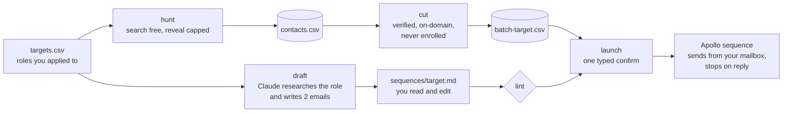

# Recruiter outbound

Goal: for every role you applied to, a short and specific email to the right recruiters, sent by Apollo
from your own mailbox, with one follow-up five days later in the same thread, stopping the moment they
reply. Built on the same design as the vestige outbound pipeline (`vsahasi/vestige/outbound`): Apollo
search is free, each email reveal costs one credit and is capped, the copy lives in markdown files,
and Apollo sequences do the sending, so nothing depends on SMTP from your laptop.



## One-time setup

1. **Install.** From this folder: `python3 -m venv .venv && source .venv/bin/activate && pip install -r requirements.txt`
2. **Keys.** `cp .env.example .env`, then fill in `APOLLO_API_KEY` (Apollo: Settings > Integrations > API,
   a master key) and `ANTHROPIC_API_KEY`.
3. **Connect your mailbox in Apollo.** Apollo: Settings > Mailboxes > Link mailbox, sign in with the
   Google account you send from. Then `python3 outbound.py mailboxes` and
   `python3 outbound.py mailboxes --save <id>` to pick it.
4. **Sending schedule.** Each sequence uses the schedule marked default in Apollo's sequence settings.
   Set it to weekday mornings in your recipients' time zone.
5. **Your files.** In `targets.csv` set `enabled` to `yes` on the roles to reach out about (`applied` to
   `yes` if you submitted; the email only says "I applied" then). `profile.md` holds your facts.
6. **Check.** `python3 outbound.py check` tests every key, the mailbox, and API access to sequences.

## Every new batch of roles

```bash
python3 outbound.py run                         # hunt + cut + draft for every enabled target
open sequences/                                  # read and edit each <target>.md
python3 outbound.py lint                        # style check after your edits
python3 outbound.py launch --target <target>    # shows exactly who gets what, then asks you to type yes
python3 outbound.py stats                       # delivered, opened, replied per sequence
```

**Resume.** Apollo has no API for attachments, so there are two modes, set in `profile.md`:
- `Resume: attach` (default). The first `launch` creates the sequence paused and tells you where to
  click: attach the PDF to email 1 and turn the sequence on in Apollo. The second `launch` enrolls the
  recruiters after your confirm. It never re-uploads the copy after you attach, so the attachment
  cannot be dropped by an update. If Apollo does not report an attachment on email 1, launch asks you
  directly; `--yes` never answers that question (pass `--resume-attached` once you have checked).
- `Resume: https://...` (a public link, e.g. Google Drive "anyone with the link"). The link is added to
  email 1 and `launch` does everything in one pass. A link in a first email is slightly worse for
  deliverability, which matters little at this volume.

`lint` checks the copy against the current mode, so copy drafted for one mode cannot launch under the
other: after switching, run `draft --redo --target <target>` or fix email 1 by hand.

**Review markers.** A draft can start with a `NO VERIFIED FACT` line (research found nothing it could
verify, so the company paragraph has no specifics) or a `RESEARCH INCOMPLETE` line (the research turn
was cut off, so eligibility was not fully checked). Launch is blocked until you have read the copy and
deleted the line.

## Commands

| Command | Does | Costs |
|---|---|---|
| `check` | keys, mailbox, sequences API access, targets, profile | free |
| `run [--max 10] [--per-company 2]` | hunt, cut, draft for every enabled target | credits + Claude |
| `hunt [--target T] [--max 10]` | search recruiters, reveal the best until 2 verified emails per target | 1 credit per reveal |
| `cut [--target T]` | write `batch-T.csv`: verified, on the company domain, never enrolled | free |
| `draft [--target T] [--redo]` | research the role with Claude, write `sequences/T.md` | about $0.20 to $0.50 |
| `lint [--target T]` | check the copy against the style rules | free |
| `launch --target T` | push the copy, activate, enroll after your typed yes | Apollo sends |
| `create --target T [--activate]` | push the copy only, e.g. after editing (re-check the resume attachment after) | free |
| `enroll --target T [--dry-run]` | enroll new batch rows into an existing sequence, same checks as launch | Apollo sends |
| `stats` | per-sequence progress from Apollo | free |
| `mailboxes [--save ID]` | list connected mailboxes, pick the sender | free |
| `search --domain D`, `match --id ID`, `org --domain D` | debugging lookups | match costs 1 credit |

## How people are picked

`hunt` asks Apollo for recruiting titles at the company domain, ranks them (university, campus and
early-career recruiters first, then recruiters whose title matches the track, such as technical
recruiters for SWE), skips executive search, unrelated recruiting, former employees and anyone with no
email behind them, and reveals in rank order until it has 2 people with a `verified` email on the
company's own domain. Companies with no recruiter in Apollo fall back to hiring-side titles
(engineering managers, heads of product, founders). Every reveal is recorded in `contacts.csv` by Apollo
id, so re-running never pays for the same person twice, and `--max` caps credits per run.

## Files

| File | What it is | In git |
|---|---|---|
| `targets.csv` | roles, one row each (edit in Numbers). The `slug` column is filled in on first use; leave it, so editing the role text later keeps the same target | no |
| `profile.md` | your settings, signature, the only facts the writer may use, never-mention list, voice | no |
| `contacts.csv` | every revealed person, resumable | no |
| `batch-<target>.csv` | the enroll-ready cut | no |
| `sequences/<target>.md` | the copy: subject, Email 1 (day 0), Email 2 (day 5), research notes (never sent) | no |
| `campaigns.csv` | Apollo sequence id per target, plus a hash of the copy last pushed | no |
| `enrolled.csv` | who was enrolled where and when, anyone Apollo skipped and why, and `enroll_unknown` rows when Apollo failed mid-request (check those in Apollo; they are never offered again) | no |
| `.env` | keys and the chosen mailbox | no |

## Operational notes (from the live vestige runs)

- `PUT /v1/sequences/{id}` treats the payload as the complete desired state; sending it without every
  step deletes steps. All updates go through one full-state PUT, and the client refuses a PUT without
  the step list.
- `add_contact_ids` silently skips some contacts and reports them in `skipped_contact_ids`;
  `contacts_with_job_change` means Apollo thinks the person left. Do not override it; it protects your
  bounce rate. Skips are logged in `enrolled.csv`.
- A sequence without a schedule never sends, and touches must be `approved`; `create` sets both.
- Mailbox records keep stale `revoked_at` fields; trust `active` and `needs_reauth_at`.
- Rate limits use fixed one-minute windows plus hourly and daily caps. The client waits through up to
  three windows, then stops the run without marking anyone as seen, so the next run picks up where it
  left off. A POST that timed out is never re-sent blindly (it may already have been processed).

## Replies

With Apollo's default sequence settings, a reply marks the contact finished, so the follow-up never goes
to someone who answered (check that setting once in the sequence after the first launch).
Answer from your inbox, the same day if you can:
- **"Apply through the portal"**: do it, then reply with a one-line confirmation and the posting ID.
- **A referral to someone else**: thank them, then email that person yourself with one line of context.
- **"Not hiring for that"**: thank them and ask whether a nearby role fits. Do not follow up again.
- **Out of office**: check how the sequence treats auto-replies in its settings; if it finished them,
  write to them yourself after their return date.

Etiquette: two touches per person, two people per role, honest subjects (no fake "Re:"), and nobody is
ever enrolled twice.
