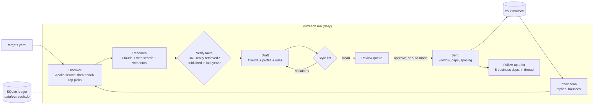

# Recruiter outreach pipeline

Finds recruiters at the companies you are applying to (Apollo), researches each company and role
(Claude with live web search), writes a short personal email in your voice with your resume attached,
and sends it on a polite schedule. Then it watches for replies, bounces, and follow-up timing.

Every stage writes to a local SQLite ledger, so the whole thing is idempotent. Re-running never
double-spends Apollo credits or emails anyone twice, and a crash halfway through just resumes.

## Architecture



| Stage | What happens | Cost | Safeguards |
|---|---|---|---|
| **Discover** | Apollo People API Search finds recruiters at the company domain (free), ranks them (university / early-career recruiters first, then track-specific recruiters such as technical recruiters for SWE, then talent acquisition), and reveals emails only for the top picks with Bulk People Enrichment. Startups with no recruiters fall back to engineering managers, heads of product, or founders. | Apollo credits, about 1 per revealed email | Only `verified` emails, only on the company's own domain, per-run credit budget, one person is never emailed about two roles, suppression list |
| **Research** | Claude (Opus 5.5) searches the web and reads the job posting, then writes a brief where every fact has a URL and a date. A second call turns it into JSON. | Roughly $0.20 to $0.50 per company | A fact is kept only if its URL was actually retrieved during research and it was published in the last 365 days. Dropped facts are listed on the review page. |
| **Draft** | Claude writes the subject and the middle paragraphs from your profile facts and the verified research. Code adds the greeting, sign-off, and signature. | Roughly $0.03 to $0.08 per email | A deterministic linter enforces the rules (no apostrophes or dashes, banned words and topics, at most 3 numbers, word range, required opening, no graduation date, fact must come from research). Failures go back to the model with the exact problems, up to 3 tries, then the draft is parked as `needs_attention`. |
| **Review** | `data/review.html` shows each email with its research, sources, and any warnings. | | `review` mode (default) sends nothing without `outreach approve`. `auto` mode approves only drafts that pass every check and have no eligibility flags. |
| **Send** | SMTP, IMAP Drafts, Gmail API, or `.eml` files. | | Send window (Mon to Thu mornings), daily cap, one new person per company per day, 90 to 240 s random spacing, recipient rejections become bounces and are suppressed. |
| **Inbox and follow-up** | Scans the mailbox for replies, bounces, and auto-replies. Five business days after an unanswered email, queues one short follow-up in the same thread. | | Follow-ups are only queued if the inbox was checked in the last 24 hours. A reply cancels anything pending. Out-of-office replies are ignored. A bounce triggers discovery of a replacement contact. |

### Files

```
recruiter-outreach/
  outreach/
    apollo.py      Apollo client: api_search, bulk_match, 429 backoff, credit budget
    contacts.py    title scoring, fallback titles, enrich-until-enough
    research.py    web research, extraction, fact verification
    writer.py      prompt, draft loop with lint feedback, follow-up template
    lint.py        style rules as code
    llm.py         Claude wrapper: refusal fallbacks, structured output, usage
    mailer.py      MIME building and the smtp / drafts / file transports
    gmail_api.py   optional Gmail API transport and inbox scan
    inbox.py       IMAP reply, bounce, and auto-reply detection
    pipeline.py    stage orchestration and the send scheduler
    review.py      the HTML review page
    db.py          SQLite ledger
    cli.py         `outreach ...` commands
  config/*.example.yaml   templates (your real *.yaml files are gitignored)
  scripts/run_daily.sh    entry point for a scheduler
  tests/                  42 tests, including a full run against a local SMTP server
```

## Setup

Needs Python 3.10 or newer. The `python3` that ships with macOS is often 3.9, so use Homebrew
(`brew install python@3.12`) if `python3 --version` is older.

Clone somewhere outside `~/Desktop` and `~/Documents`: macOS blocks background jobs from reading those
folders, and iCloud can evict files there.

```bash
git clone -b claude/peaceful-pasteur-m0ek00 https://github.com/ruhan-sahasi/UIUC-bustle ~/code/UIUC-bustle
cd ~/code/UIUC-bustle/recruiter-outreach
python3 -m venv .venv && source .venv/bin/activate
pip install -e ".[dev]"          # add ,gmail for the Gmail API option: ".[dev,gmail]"
python -m outreach init          # copies the example configs and .env into place
```

1. **Keys** go in `recruiter-outreach/.env` (gitignored):
   - `APOLLO_API_KEY`: Apollo, Settings, Integrations, API. Use a master key with access to People API Search and People Enrichment.
   - `ANTHROPIC_API_KEY`: from the Claude Console.
   - `OUTREACH_EMAIL_PASSWORD`: a Google App Password (Google Account, Security, 2-Step Verification, App passwords). Penn Arts & Sciences student mail is Google Workspace, so this normally works. If Penn has App Passwords turned off, set `delivery: gmail_api` instead (see below).
2. **Config** in `config/`:
   - `profile.yaml`: who you are, the only facts the writer may use, approved wording, and style rules.
   - `targets.yaml`: one entry per role, with company, domain, role, track, and optionally the posting URL, location, `applied: true`, and a tailored `resume:`.
   - `settings.yaml`: mode, delivery, caps, send window, and model.
3. **Check** with `python -m outreach check`. It validates config, resume PDFs, keys, the Apollo key, the Claude model, and the mailbox login.

The resume paths must point at readable PDFs. If a scheduled job cannot read `~/Desktop`, copy the
three resumes into `~/code/resumes/` and point `profile.resumes` there.

## First run

```bash
python -m outreach run --no-send     # discover, research, draft; nothing is sent
python -m outreach review --open     # read every email, its sources and warnings
python -m outreach approve --all-clean   # or: approve 3 5 8 / edit 4 / reject 6
python -m outreach send              # sends approved emails within the window and caps
python -m outreach status            # per-company progress, caps, Apollo and Claude spend
```

Once a week of drafts looks right, set `mode: auto` in `settings.yaml`. Anything that fails a check
still waits for review.

## Commands

| Command | Does |
|---|---|
| `run [--no-send] [--now] [--dry-run]` | The daily job: inbox scan, discover, research, draft, auto-approve in auto mode, follow-ups, send |
| `discover / research / draft [--target SLUG]` | One stage. `--retry` / `--redo` re-runs it for a target |
| `review [--open]`, `show ID` | Review page, or one email in the terminal |
| `approve ID... / --all-clean`, `reject ID...`, `edit ID` | Review actions. `edit` opens `$EDITOR` and re-runs the style check |
| `send [--now] [--dry-run] [--limit N]` | Send approved emails. `--dry-run` writes `.eml` files to `data/outbox` |
| `sync`, `followups` | Inbox scan, or queue due follow-ups |
| `suppress EMAIL_OR_DOMAIN`, `mark EMAIL replied` | Never contact, or record a reply by hand |
| `status`, `log`, `export [--csv PATH]` | Progress, recent events, CSV ledger |

## Running it every day

`scripts/run_daily.sh` runs `outreach run`, keeps the Mac awake with `caffeinate` while emails are
spaced out, and logs to `data/logs/`. To schedule it with launchd, save this as
`~/Library/LaunchAgents/com.recruiter-outreach.daily.plist` with the paths filled in:

```xml
<?xml version="1.0" encoding="UTF-8"?>
<!DOCTYPE plist PUBLIC "-//Apple//DTD PLIST 1.0//EN" "http://www.apple.com/DTDs/PropertyList-1.0.dtd">
<plist version="1.0">
<dict>
  <key>Label</key><string>com.recruiter-outreach.daily</string>
  <key>ProgramArguments</key>
  <array><string>/bin/bash</string><string>/Users/YOU/code/UIUC-bustle/recruiter-outreach/scripts/run_daily.sh</string></array>
  <key>StartCalendarInterval</key>
  <array>
    <dict><key>Hour</key><integer>9</integer><key>Minute</key><integer>35</integer></dict>
    <dict><key>Hour</key><integer>11</integer><key>Minute</key><integer>45</integer></dict>
  </array>
</dict>
</plist>
```

Then load it with `launchctl bootstrap gui/$(id -u) ~/Library/LaunchAgents/com.recruiter-outreach.daily.plist`
and remove it with `launchctl bootout gui/$(id -u)/com.recruiter-outreach.daily`. The morning run
prepares and sends. The late-morning run sends anything you approved in between. Runs outside the send
window only prepare drafts. If the Mac is asleep at the scheduled time, launchd runs the job when it wakes.

## Mail delivery options

| `delivery` | Use when |
|---|---|
| `smtp` | Default. Gmail or Google Workspace with an App Password, or Outlook or any SMTP server via `provider: custom`. |
| `drafts` | You want every email to land in your Drafts folder and to press send yourself. Uses the same App Password over IMAP. |
| `gmail_api` | App Passwords are disabled on your account. Create an OAuth Desktop client in Google Cloud Console with the Gmail API enabled, save it as `config/gmail_client_secret.json`, install the `gmail` extra, and run `outreach check` once to consent in the browser. |
| `file` | Dry runs. Writes `.eml` files you can open in Mail. |

Reply and bounce detection reads the mailbox: IMAP for `smtp` and `drafts`, the Gmail API for `gmail_api`.
For Gmail it scans All Mail, so replies that skip the inbox are still seen.

## Costs

- **Apollo**: search is free. Revealing an email costs credits, about 1 each, depending on your plan.
  `limits.apollo_enrich_per_run` caps credits per run, and `status` shows what was used.
- **Claude**: Opus 5.5 is $4 per million input tokens and $20 per million output tokens, plus $0.01 per web
  search. Expect roughly $0.20 to $0.50 per company researched and a few cents per email. `status`
  prints a running estimate from the recorded token usage.

## Tests

```bash
pip install -e ".[dev]" && python -m pytest -q
```

The suite mocks Apollo over HTTP and fakes the Claude client, and the end-to-end tests send through a
real SMTP server on localhost. They cover discovery, ranking and credit budgets, a research pause and
resume, fact verification, the lint-and-retry loop, caps and windows, threading, replies, bounces,
auto mode, and dry runs.

## Privacy

This repository is public. Your `config/*.yaml`, `.env`, OAuth tokens, and `data/` (the ledger, review
pages, and outbox) are gitignored and never leave your machine.
